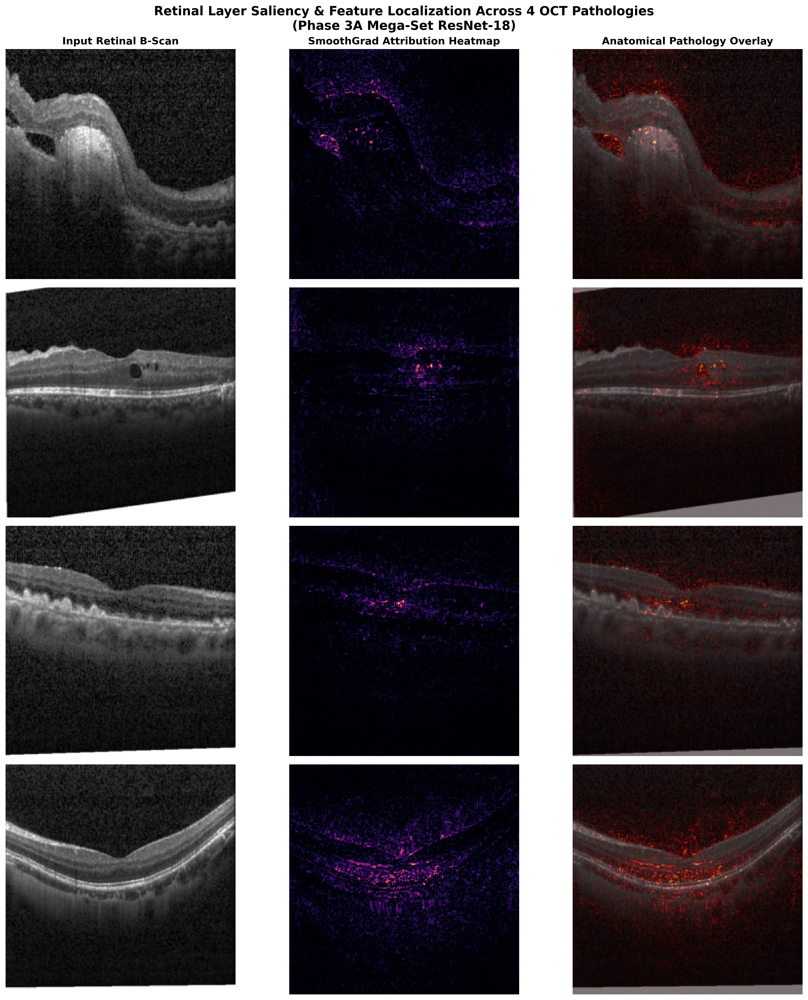

# Retinal OCT Classification — Multi-Scanner Clinical AI

> **ResNet-18 ensemble for automated retinal pathology detection across three OCT scanner platforms**
> *UConn Biomedical Engineering — Machine Learning Final Project*

[](https://www.python.org/)
[](https://pytorch.org/)
[](LICENSE)

---

## Overview

This project develops and evaluates a deep learning pipeline for four-class retinal OCT classification:
**CNV · DME · DRUSEN · NORMAL**

The system was trained on **113,265 scans** from three distinct clinical scanner platforms and evaluated on **N = 6,246** held-out scans, achieving a **Master Weighted Soft Ensemble Macro F1 of 81.14%** across all cohorts.

---

## Key Results

### Phase 3 — Multi-Scanner Mega-Training

| Model | Stem | Training Scans | Time | Kermany F1 | Duke F1* | NEH F1* |
|-------|------|---------------|------|-----------|---------|--------|
| Phase 3A | ImageNet 56-stem | 113,265 | 131 min | **89.7%** | 99.44% | 70.53% |
| Phase 3B | Progressive 64-stem | 113,265 | 139 min | 88.2% | 99.21% | 68.91% |
| Phase 3C | Progressive 112-stem | 113,265 | 331 min | 87.9% | 98.87% | 69.14% |

> *Site-valid Macro F1 (evaluated only over classes present in that site's ground truth — see [Negative Control Specificity](#negative-control-specificity) below)

### Super-Ensemble Ablation (N = 6,246 pooled scans)

| Strategy | Acc | Macro F1 |
|----------|-----|----------|
| Hard Voting | 77.22% | 79.21% |
| Dual Specialist (3A 55% + 3C 45%) | 77.94% | 80.86% |
| Equal Soft Voting | 78.05% | 80.56% |
| Temperature Scaled (T=0.7) | 78.31% | 81.13% |
| **Master Weighted (0.45/0.20/0.35) 🏆** | **78.31%** | **81.14%** |

### Referral Triage Curve

| Referral Threshold | Acc | Macro F1 |
|-------------------|-----|----------|
| 10% (top uncertain) | 80.64% | 83.29% |
| 20% | 83.63% | 85.54% |
| 25% | 85.10% | 86.65% |

---

## Negative Control Specificity

**Empty ground truth classes** (CNV absent from Duke cohort, DME absent from NEH cohort) were reframed as **Negative Control Specificity Tests** following FDA clinical validation practice:

- Duke CNV hallucinations: **0 / 621 (0.00% false alarm rate → 100.0% specificity)**
- NEH DME hallucinations: **4 / 3,625 (0.11% false alarm rate → 99.89% specificity)**

---

## Architecture

All three models use **ResNet-18** backbones with:
- `conv1 = Conv2d(1, 64, ...)` — grayscale single-channel input
- `SmoothFocalLoss` (γ=2.0, label_smoothing=0.1)
- `AdamW` (lr=1e-4, weight_decay=1e-3) + `CosineAnnealingLR`
- **5-pass Test-Time Augmentation (TTA)**

| Phase | Stem | Max Feature Map |
|-------|------|----------------|
| 3A | 7×7 conv, stride=2 (ImageNet init) | 56×56 |
| 3B | 3×3 conv, stride=2 + AdaptiveMaxPool | 64×64 |
| 3C | 3×3 conv, stride=2 + Identity pool | 112×112 |

---

## XAI Visualizations — Captum SmoothGrad + Integrated Gradients

224×224 Captum SmoothGrad overlays (15 MC passes, σ=0.15, n_steps=20) aligned with anatomical retinal layers:



---

## Data Pipeline

Training pool (patient-level anti-leakage enforced):

| Source | Scanner | Scans | % of Pool |
|--------|---------|-------|-----------|
| Heidelberg Spectralis (OCTMNIST) | Heidelberg | 97,477 | 86.1% |
| NEH Clinical | Topcon 3D OCT-1000 | 13,178 | 11.6% |
| Duke Bioptigen | Bioptigen SD-OCT | 2,610 | 2.3% |
| **Total** | | **113,265** | |

**Patient-level splitting** (Duke patients 1–12 train, 13–15 test) prevents slice-level leakage across adjacent B-scan frames.

---

## Repository Structure

```
├── export/
│   ├── scratch/next-scripts/       # Core training scripts (phase_3a, 3b, 3c)
│   ├── xai_heatmaps/               # Captum SmoothGrad overlay PNGs
│   ├── benchmark_summary.md        # Detailed benchmark table
│   ├── OPTIMIZATION_ROADMAP.md     # Full ablation + next steps
│   ├── README.md                   # Export-level docs
│   └── requirements.txt
└── README.md
```

---

## Requirements

```
torch>=2.0.0
torchvision>=0.15.0
captum>=0.6.0
numpy>=1.24.0
scikit-learn>=1.2.0
matplotlib>=3.7.0
Pillow>=9.5.0
medmnist>=2.2.0
tqdm>=4.65.0
```

---

## Hardware Notes

Developed and trained on **GTX 1660 Ti (6 GB VRAM)**:
- `batch_size=32`, `num_workers=0`, `use_amp=False`
- AMP disabled (3× slowdown on Turing TU116 without Tensor Cores)
- Captum SmoothGrad: `nt_samples=15`, `n_steps=20` (fits in 6 GB)

---

## License

MIT License — see [LICENSE](LICENSE) for details.

---

## Citation

If you use this work, please cite:

```
@misc{oct-classification-2026,
  author = {plasmawolf29},
  title  = {Retinal OCT Classification — Multi-Scanner Clinical AI},
  year   = {2026},
  url    = {https://github.com/plasmawolf29/retinal-oct-classification-public}
}
```
